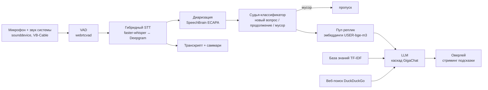

# call-assistant — подсказки оператору во время звонка

Голосовой копилот для живых звонков (Zoom, Teams, Discord, Meet). Слушает разговор, распознаёт речь, понимает, кто говорит, и показывает оператору короткую подсказку-ответ в окне поверх экрана. Демо-сценарий — поддержка интернет-провайдера «СетьПлюс» (вымышленная компания, база знаний в `data/knowledge_base.json`).

## Архитектура



## Что внутри

- **Гибридное распознавание речи.** Локальный faster-whisper на GPU; если он не успевает за реальным временем (RTF > 0.85 три фразы подряд), система переключается на облачный Deepgram и возвращается обратно, когда локальная модель снова успевает. На машине без GPU — откат на CPU с int8.
- **Диаризация.** Голосовой отпечаток каждой фразы (SpeechBrain ECAPA) сравнивается с уже встреченными голосами по косинусной близости, порог настраивается.
- **Судья-классификатор.** Перед генерацией LLM классифицирует реплику: новый вопрос, продолжение темы или мусор (поддакивания, обрывки). Ответ — строгий JSON. Мусор не доходит до дорогой модели.
- **Семантический поиск по разговору.** Каждая содержательная реплика и каждый ответ ассистента превращаются в эмбеддинг (USER-bge-m3, 8192 токена контекста). При отсылке к прошлой теме в промпт подтягивается пара «вопрос + ответ» целиком, а не только последние строки.
- **LLM-слой.** GigaChat с каскадом моделей (3-Ultra → 2-Max → 2-Pro → 2): при исчерпании квоты (HTTP 402) запрос уходит на следующую модель. Ошибки классифицируются по кодам (401/403, 429, 5xx, таймауты) и показываются в интерфейсе. Стриминг ответа в оверлей.
- **Источники фактов.** База знаний (TF-IDF с IDF-весами) и веб-поиск для быстро меняющихся фактов; модель сама решает, нужен ли поиск.
- **Саммари звонка** после завершения.

## Оценка качества

- 10+ наборов сценариев (`src/batch_test_*.py`) для регресса промптов и сравнения моделей: локальная Ollama (Qwen2.5, Gemma2) против GigaChat.
- Стресс-тест на 299 репликах: без единой ошибки; судья — медиана 1,7 с, 90-й перцентиль 2,0 с; генерация подсказки — медиана 2,0 с.
- Судья на наборе каверзных случаев (`data/judge_test_cases.json`): 15 из 15.

- Ручной прогон 10 сценариев оператора (`data/eval_operator_scenarios.json`) — найденные проблемы и исправления описаны в `evals/README.md`.
- Юнит-тесты (`pytest`): фильтр поддакиваний, повторы и классификация ошибок GigaChat без сети, поиск по базе знаний.

## Стек

Python · faster-whisper · Deepgram · SpeechBrain · webrtcvad · sentence-transformers (USER-bge-m3) · GigaChat API · Ollama · Tkinter

## Запуск

```
python -m venv venv
venv\Scripts\activate
pip install -r requirements.txt
copy .env.example .env      # заполнить ключи GigaChat / Deepgram и номера аудиоустройств
python src/list_audio_devices.py
python src/main.py
```

Esc в окне подсказок — завершить звонок, сохранить транскрипт и саммари.
